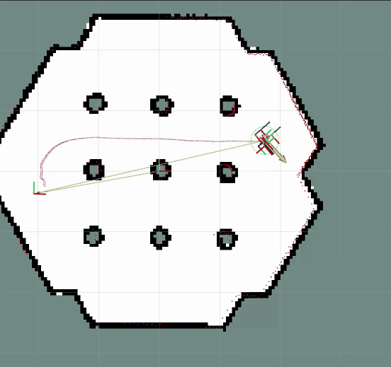
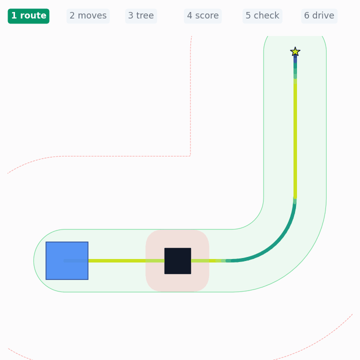
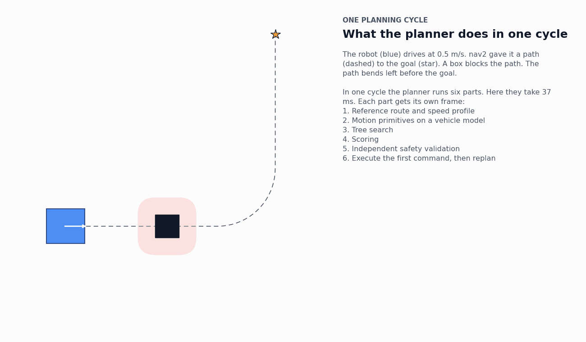

# nice_differential_drive_trajectory_planner

[](docs/turtlebot3_demo.webm)

*The planner driving a TurtleBot3 in the nav2 simulation, at 2× speed. Click for the full recording.*

This is a nice [nav2](https://docs.nav2.org/) controller plugin for differential-drive robots that only drive forward and constrains the robot to not deviate more than configured amount from the path. Each control cycle it simulates hundreds of short commands. It discards the ones that collide or leave the path. It picks the best of the rest. A separate checker verifies the winner. Only then does the robot move.

> **Status: experimental.** It drives the nav2 TurtleBot3 simulation with the default behavior tree. Nobody has
> benchmarked it against MPPI or DWB yet. So it makes no claim to be better. See [Status](#status).



*The planner in closed loop. Each cycle lights up the six stages in turn: route, moves, tree, score, check, drive.
The robot then moves and the next cycle starts. The GIF shows every fifth cycle, slowed down. In reality one cycle
takes a few tens of milliseconds.*

## How it works



*One real planning cycle, part by part. Each frame covers one of the six parts below: the speed profile, the
moves and the vehicle model, the six tree steps, scoring, safety validation and the executed command. Every line is
a move the planner simulated.*

Each cycle runs six steps:

1. **Route and speed.** The planner turns nav2's path into a smooth route. It sets a target speed for every point.
   The speed drops in bends and reaches zero at the goal. The planner finds the robot on the route by searching only
   nearby. A parallel aisle cannot confuse it.
2. **Moves.** From any state the planner tries up to 24 moves of 0.4 s. It can stop, turn in place, follow the route
   or follow a copy shifted left or right. The shifted copies let it pass obstacles. It tries each move at a few
   speeds. A vehicle model plays every move out. The model respects speed, acceleration and wheel limits. It never
   reverses.
3. **Tree.** The planner chains moves into futures 2.4 s long, six steps deep. After each step it drops moves that
   hit something or leave the corridor. It keeps the 30 most promising futures. It reserves a few slots for each
   kind of plan, so one idea cannot crowd out the rest.
4. **Score.** The planner scores each finished future. It rewards progress along the route. It penalises distance
   from the route, speed off the target, harsh motion, closeness to obstacles and changing its mind. A future that
   could not brake in time never gets a score.
5. **Check.** A separate checker re-tests the best futures against the robot's real limits. It also checks that
   the robot could still stop after the first move. If nothing passes, the robot brakes.
6. **Drive.** The robot executes only the first move. The next cycle starts again from the new position.

The search stops after 35 ms and uses the best futures it has fully checked. All numbers above are parameters.

## What you can see in RViz

The controller publishes its markers on `/<controller name>/markers` (`/FollowPath/markers` in the example). The
included RViz config shows them:

| Layer | Shows |
|---|---|
| `tree` | Every move tried this cycle. Frontier moves show their speed as colour. Dropped moves are grey. Rejected moves are red (collision), orange (left the corridor) or purple (could not brake in time). Red dots mark contacts. |
| `candidates` | The sequences that reached the safety check. Red ones failed it. |
| `candidate_labels` | Rank, manoeuvre, score and verdict per candidate. Off by default (`visualization.labels`). |
| `selected`, `selected_footprints` | The executed sequence and the robot's outline along it. |
| `stop_check` | Where the robot would stop if it braked now. |
| `corridor` | The preferred corridor (green) and the hard limit (red). |
| `reference` | The route coloured by reference speed. |
| `offset_targets`, `projection` | The points the offset moves aim at. Where the robot sits on the route. |
| `status` | One short line over the robot. It shows the manoeuvre and speed, or why the robot brakes. |

The controller also publishes `/<controller name>/diagnostics` as a `diagnostic_msgs/DiagnosticArray`. It holds the
planning time, node counts, rejections by reason and the selected sequence's cost per term.

## Try it

It works with ROS 2 Lyrical and nav2 1.5.

```bash
mkdir -p ~/ws/src && cd ~/ws/src
git clone git@github.com:Nisarg236/nice_differential_drive_trajectory_planner.git
cd ~/ws && colcon build --packages-select nice_differential_drive_trajectory_planner
source install/setup.bash
ros2 launch nice_differential_drive_trajectory_planner tb3_simulation.launch.py   # headless:=False opens Gazebo
```

Click **Nav2 Goal** in RViz to send a goal. The launch file runs nav2's own TurtleBot3 simulation and default behavior
tree. It swaps only the `FollowPath` controller.

To use it on your robot, copy the `FollowPath` block from [config/nav2_params_tb3.yaml](config/nav2_params_tb3.yaml)
into your nav2 params. Then set `limits` for your robot. The controller rejects invalid values at startup. The error
names the parameter.

The TurtleBot3 config keeps the robot close to its path. It uses a 0.15 m preferred corridor, a 0.5 m hard limit and
route weight 3. With these settings the robot waits behind a small obstacle. It does not detour. The animation uses
the looser library defaults (0.3 m, 1.0 m, route weight 1). With those the robot passes.

## Parameters

All parameters sit under the controller's name (`FollowPath.` in the example). The controller reads them once at
startup.

| Group | Main parameters |
|---|---|
| `limits` | `max_v`, `max_omega`, `max_accel`, `max_brake`, `max_angular_accel`, `wheel_radius`, `wheel_separation`, `max_wheel_speed` |
| `dynamics` | `linear_time_constant`, `angular_time_constant`, `delay` (all 0 by default) |
| `speed_profile` | `max_speed`, `max_lateral_accel`, `decel`, `curvature_window` |
| `corridor` | `filter_dist` (preferred corridor), `max_route_deviation` (hard limit) |
| `primitives` | `duration`, `integration_dt`, `lateral_offsets`, `rotate_speed`, `rotate_heading_threshold`, `max_successors` |
| `search` | `frontier_size`, `horizon_time`, `horizon_distance`, `max_nodes`, `max_primitive_evaluations`, `time_budget`, `max_candidates` |
| `scoring` | `<term>_weight` per score term, `disabled_terms` to switch terms off |
| `collision`, `safety` | Check resolution, obstacle margin, `unknown_is_lethal`, `brake_factor`, input age limits |
| `visualization` | `candidates`, `footprints`, `reference`, `corridor`, `labels`, `obstacles`, `tree` (off by default, heavy) |

## Tests

```bash
colcon test --packages-select nice_differential_drive_trajectory_planner && colcon test-result --verbose
```


## Status

Working:

- The full planning loop above as a nav2 controller plugin.
- The safety checker and braking fallback.
- RViz markers and diagnostics.

Known issues:

- In tight spaces the search often uses its whole 35 ms budget.

## License

[Apache-2.0](LICENSE)
